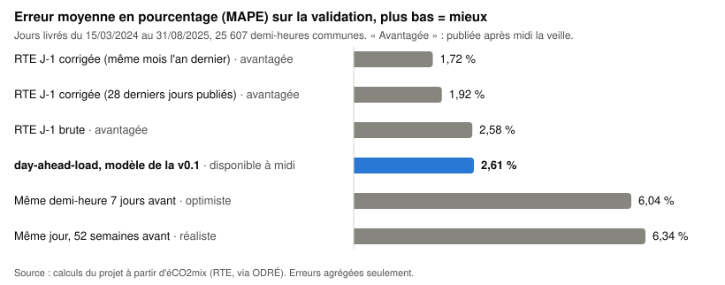
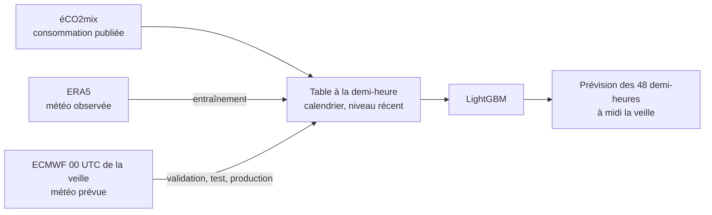

# day-ahead-load

[](https://github.com/mangnathan/day-ahead-load/actions/workflows/ci.yml) [](LICENSE) [](pyproject.toml)

**Prévoir la consommation électrique française du lendemain, demi-heure par demi-heure, avec les seules données disponibles au moment où un fournisseur doit acheter.**

État : la prévision ponctuelle (v0.1) et son incertitude (v0.2) sont terminées et mesurées sur la période de validation. La v0.3, qui traduit la prévision en décision d'achat, est la prochaine étape. La période de test reste fermée jusqu'à la v1.0.

<picture>
  <source media="(prefers-color-scheme: dark)" srcset="docs/images/mape-validation-sombre.svg">
  
</picture>

## Le problème

Un fournisseur d'électricité achète la veille, avant midi, l'énergie que ses clients consommeront le lendemain. S'il achète trop ou trop peu, l'écart est réglé après coup au prix des écarts, souvent défavorable. Il lui faut donc, chaque matin, une prévision de la consommation pour chacune des 48 demi-heures du lendemain.

RTE, le gestionnaire du réseau, publie sa propre prévision du lendemain. Elle est très bonne, mais elle arrive après midi, trop tard pour cette décision, et sans fourchette d'incertitude.

Le projet se met à la place d'un fournisseur dont les clients consomment comme la France entière, à une échelle près. Il construit la prévision que ce fournisseur pourrait réellement avoir à midi, la mesure honnêtement, puis la traduira en quantité à acheter et en coût.

## Résultats

Mesurés sur la période de validation, du 15/03/2024 au 31/08/2025, avec la météo telle qu'elle était prévue la veille.

**La prévision**, réentraînée chaque mois sur les seuls jours déjà publiés :

| | MAPE | Référence − modèle, en points (intervalle à 95 %) |
|---|---|---|
| **Prévision de day-ahead-load** | **2,67 %** | |
| Même demi-heure 7 jours avant | 6,04 % | +3,37 [+2,55 ; +4,25] |
| Même jour, 52 semaines avant | 6,34 % | +3,68 [+2,84 ; +4,54] |
| RTE J-1 brute, publiée après midi | 2,58 % | −0,08 [−0,37 ; +0,20] |
| RTE J-1 corrigée de son biais récent, publiée après midi | 1,72 à 1,92 % | −0,95 à −0,75 |

- La prévision fait moins de la moitié de l'erreur des prévisions naïves. Elle fait jeu égal avec la prévision brute de RTE, qui n'est pourtant pas disponible à l'heure de la décision, et reste derrière ses versions corrigées.
- Avec une météo parfaite, impossible en pratique, l'erreur ne baisse que de 0,03 point : à un jour, l'erreur vient surtout du modèle, pas de la prévision météo.
- Le modèle prévoit trop par temps froid, de 0,67 à 0,85 GW sous 10 °C, ainsi que les jours de pont et à Noël.
- Le modèle de la v0.1, entraîné une seule fois, faisait 2,61 % sur les mêmes demi-heures. L'écart avec la version réentraînée chaque mois n'est pas distinguable du bruit.

**La fourchette** : intervalles à 80 % et 95 % calibrés sur l'année de validation (77,5 % et 94,2 %), trop étroits en hiver (65,8 % et 88,2 %). Mesurée du 02/09/2024 au 31/08/2025, premiers jours qui disposent de 90 jours d'erreurs publiées.

Ces chiffres sont probablement optimistes : treize modèles ont été comparés sur cette même période, la météo prévue de la validation est en partie rejouée par ECMWF, et le naïf à 7 jours lit des données qu'un fournisseur n'aurait pas encore. Les critères de réussite, fixés avant toute modélisation, se jugent sur la période de test, ouverte une seule fois en v1.0. Le détail est dans les rapports de la [v0.1](docs/pdf/day-ahead-load_v0.1_Rapport-prevision-ponctuelle.pdf) et de la [v0.2](docs/pdf/day-ahead-load_v0.2_Rapport-incertitude.pdf) (PDF).

## Comment ça marche



1. **Une table, une ligne par demi-heure.** La consommation nationale vient d'éCO2mix (RTE). Le calendrier marque les fériés, le lundi de Pentecôte, les ponts et la période de Noël. Le niveau récent de la consommation est la moyenne des 52 dernières semaines déjà publiées à midi la veille.
2. **Une météo nationale.** La température, la nébulosité, le vent et le rayonnement sont lus en 12 points, un par grande région, puis pondérés par la consommation de chaque région. À l'entraînement, ils viennent de la réanalyse ERA5. Ensuite, ils viennent du calcul ECMWF lancé à 00 UTC la veille, le dernier disponible à coup sûr avant midi.
3. **Rien de postérieur à midi la veille.** Un test remplace par une valeur absurde toute donnée publiée après l'heure de décision, et vérifie que la prévision ne change pas. Quand un calcul météo manque, le précédent prend le relais, et chaque cas est enregistré.
4. **Le modèle.** LightGBM aux réglages par défaut, avec une graine fixée, entraîné depuis 2017. Il est réentraîné au début de chaque mois sur les seuls jours déjà publiés en consolidé : le modèle du mois M apprend jusqu'à la fin du mois M − 4, et un test refuse toute ligne plus récente.
5. **La fourchette.** Chaque quantile ajoute à la prévision le quantile des erreurs passées de la même demi-heure, publiées avant midi la veille, sur 12 mois au plus. Les intervalles à 80 % et à 95 % vont des quantiles 0,1 à 0,9 et 0,025 à 0,975.

## Méthode

- **Un cadre fixé avant de modéliser.** Le besoin, les données, les références à battre, le découpage dans le temps et les critères de réussite et d'échec ont été écrits avant tout modèle ([ADR 0001](docs/adr/0001-cadrage.md)).
- **Un test ouvert une seule fois.** L'entraînement s'arrête au 14/03/2024, la validation au 31/08/2025. Le test, du 01/09/2025 au 31/08/2026, ne sera lu qu'en v1.0.
- **Chaque choix a sa règle, écrite avant le calcul.** Le [journal des choix](docs/v0.1-prevision-ponctuelle/journal-des-choix.md) note, date et commite chaque règle avant le calcul qui la tranche. Il compte aussi les modèles évalués sur la validation, treize à ce jour, parce que chaque comparaison rend le score de validation un peu plus flatteur.
- **Un gain doit sortir du bruit.** Un modèle plus complexe n'est retenu que s'il gagne plus de 1 % et si l'intervalle de confiance à 95 % de la différence, obtenu en tirant au hasard des semaines entières, ne contient pas 0. Cette règle a écarté une correction de la météo qui gagnait 1,6 %.
- **Des références étiquetées.** Chaque référence est dite réaliste, optimiste ou avantagée selon les données qu'elle utilise. La prévision de RTE est comparée, jamais visée.

## Limites

- Les résultats portent sur la validation, qui a servi aux choix : ils sont optimistes, et seul le test les confirmera.
- Les prévisions météo archivées de mars à novembre 2024 sont des calculs rejoués par ECMWF, et rien n'établit que celles de novembre 2024 à mai 2026 soient les prévisions publiées à l'époque.
- Le portefeuille est la consommation nationale mise à l'échelle. Un vrai portefeuille, plus petit, varie davantage.
- Les vacances scolaires et le calendrier propre à l'Alsace-Moselle ne sont pas dans le modèle.
- Le biais par temps froid n'a pas d'explication établie, et les deux pires jours de la validation tombent sur les deux premiers jours de l'archive de météo prévue, où la température lissée sur 72 heures manque.
- Les intervalles sont trop étroits en hiver sur la validation, faute d'erreurs d'hiver dans leur fenêtre de calibration. Sur le test, ils mélangeront les saisons : on s'attend à une couverture trop basse en hiver et trop haute en été.

## Versions

| Version | Contenu | État |
|---|---|---|
| v0.0 | Étude de faisabilité : besoin, données, références, critères | [Rapport (PDF)](docs/pdf/day-ahead-load_v0.0_Rapport-de-faisabilite.pdf) |
| v0.1 | Prévision ponctuelle choisie et mesurée sur la validation | [Rapport (PDF)](docs/pdf/day-ahead-load_v0.1_Rapport-prevision-ponctuelle.pdf) |
| v0.2 | Incertitude : réentraînement mensuel, intervalles à 80 % et 95 % | [Rapport (PDF)](docs/pdf/day-ahead-load_v0.2_Rapport-incertitude.pdf) |
| v0.3 | Décision d'achat et coût des écarts | prochaine étape |
| v0.4 | Chaîne quotidienne automatisée | prévu |
| v0.5 | Déploiement sur AWS, offre gratuite | prévu |
| v1.0 | Ouverture unique du test et bilan | prévu |

Chaque version a sa note de décision dans [docs/adr](docs/adr). Le détail des changements est dans le [CHANGELOG](CHANGELOG.md).

## Technique

Python 3.12, uv, pandas, LightGBM, la bibliothèque `holidays` pour les jours fériés, GitHub Actions pour la CI et pour une mesure quotidienne de l'heure de publication des calculs météo, LaTeX (Tectonic) pour les rapports. Le code est typé (mypy strict) et vérifié par ruff. Plus de cent tests tournent sur des données fabriquées, et toute connexion réseau pendant un test le fait échouer. La CI bloque toute fusion qui ne passe pas. Le projet ne coûte rien : offres gratuites uniquement, avec un plafond d'appels inscrit dans le code.

## Lancer le projet

Prérequis : Python 3.12 et [uv](https://docs.astral.sh/uv/). Les rapports se compilent avec [Tectonic](https://tectonic-typesetting.github.io).

```bash
uv sync
uv run pytest
```

Les mêmes contrôles que la CI :

```bash
uv sync --locked
uv run --no-sync ruff check .
uv run --no-sync ruff format --check .
uv run --no-sync mypy
uv run --no-sync pytest
```

<details>
<summary>Reproduire les mesures (téléchargements, table, comparaisons, bilan, rapports)</summary>

Les données téléchargées vont dans `data/`, jamais versionné. Les scripts de la v0.1 lisent le téléchargement d'éCO2mix du 14/11/2026, dont l'empreinte sha256 est notée dans [table-resume.json](docs/v0.1-prevision-ponctuelle/data/table-resume.json) : un téléchargement fait un autre jour contient d'autres données consolidées.

```bash
# Consommation (éCO2mix, via ODRÉ) et références de la v0.0
uv run python scripts/feasibility/measure_eco2mix.py --date 2026-11-14
uv run python scripts/feasibility/measure_references.py --date 2026-11-14

# Météo (Open-Meteo) : environ 19 100 appels, plafond local de 8 000 par jour,
# arrêt définitif au premier refus de quota ; une nouvelle séance reprend où la précédente s'est arrêtée.
# Le contrôle des 12 points (étape « controle ») est déjà versionné dans docs/v0.0-faisabilite/data.
uv run python scripts/feasibility/download_weather.py estimation
uv run python scripts/feasibility/download_weather.py telecharger

# v0.1 : table, convention de la demi-heure, sources météo, familles de modèles, bilan
uv run python scripts/modelling/build_table.py
uv run python scripts/modelling/measure_half_hour_convention.py
uv run python scripts/modelling/compare_sources.py
uv run python scripts/modelling/compare_families.py
uv run python scripts/modelling/assess_v0_1.py

# v0.2 : réentraînement mensuel, quantiles et intervalles
uv run python scripts/modelling/compare_intervals.py

# Figure de ce README, puis rapports
uv run python scripts/docs/readme_figure.py
cd docs/v0.0-faisabilite && tectonic -X compile v0.0-rapport-de-faisabilite.tex
cd ../v0.1-prevision-ponctuelle && tectonic -X compile v0.1-rapport-prevision-ponctuelle.tex
cd ../v0.2-incertitude && tectonic -X compile v0.2-rapport-incertitude.tex
```

En dehors des téléchargements, chaque script ne lit que le cache local. Les comparaisons relancées redonnent des fichiers de résultats identiques.

</details>

## Structure du dépôt

```
src/day_ahead_load/              code : téléchargements, table, météo, calendrier, modèles,
                                 références, mesures du bilan, quantiles
scripts/feasibility/             étude de faisabilité (v0.0)
scripts/modelling/               table, comparaisons et bilan de la v0.1, intervalles de la v0.2
scripts/monitoring/              mesure quotidienne de l'heure de publication des calculs météo
scripts/docs/                    figure du README
tests/                           tests unitaires sur des données fabriquées, sans réseau
docs/adr/                        notes de décision
docs/v0.0-faisabilite/           rapport LaTeX et chiffres de la v0.0
docs/v0.1-prevision-ponctuelle/  journal des choix (v0.1 et suivantes), rapport LaTeX et chiffres de la v0.1
docs/v0.2-incertitude/           rapport LaTeX et chiffres de la v0.2
docs/pdf/                        rapports compilés
.github/workflows/               CI et mesure quotidienne
```

## Données

Le projet n'utilise que des données publiques :

- **éCO2mix** (RTE) : consommation nationale et prévision J-1 de RTE, via la plateforme ODRÉ, sous [Licence Ouverte 2.0](https://www.etalab.gouv.fr/licence-ouverte-open-licence/).
- **Open-Meteo** : réanalyse ERA5 (Copernicus) et calculs du modèle IFS d'ECMWF, sous licence [CC BY 4.0](https://creativecommons.org/licenses/by/4.0/).
- **INSEE** : aires d'attraction des villes 2020, pour le choix des 12 points météo, sous Licence Ouverte 2.0.

Le dépôt ne contient aucune série de consommation ni aucune courbe de RTE, seulement des chiffres agrégés calculés à partir de ces données. Ce projet est indépendant : il n'est ni soutenu ni validé par RTE, ECMWF ou Open-Meteo.

## English summary

day-ahead-load forecasts French national electricity consumption for the next day, for each half-hour, using only the data a supplier actually has at noon the day before, when it must buy. Version 0.1 selects a LightGBM model on a validation period (March 2024 to August 2025); version 0.2 retrains it every month on published data only, which gives 2.67 % MAPE, less than half the error of naive forecasts and on par with the grid operator's own raw day-ahead forecast, published after the decision time. Version 0.2 also adds 80 % and 95 % intervals from the model's past errors: they cover 77.5 % and 94.2 % of half-hours over the validation year, but are too narrow in winter (65.8 % and 88.2 %). Every modelling choice follows a rule committed before the computation, gains must clear a block-bootstrap noise test, and the test year stays closed until version 1.0. Next: the purchase decision and its cost (v0.3).

## Auteur et licence

Projet personnel de Nathan Mang. Code sous licence [MIT](LICENSE).
